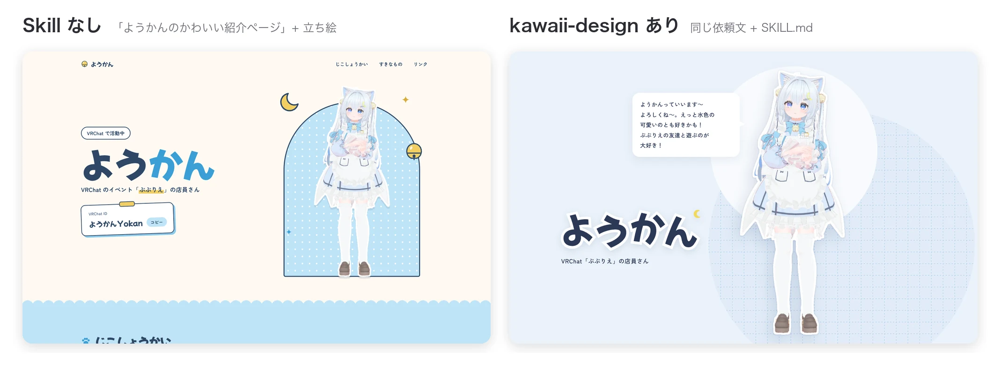
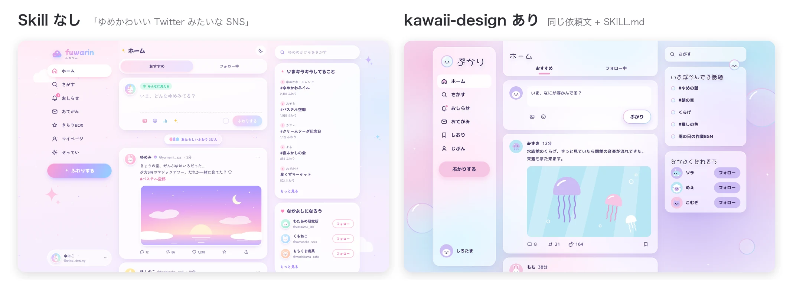

# kawaii-design

UIそのものに可愛さを持たせるが、キャラクターや作品などのコンテンツがあるときは、UIはそれを引き立てる脇役に回る。

kawaii-design は Claude Code、Codex などで使える Skill です。英語の「cute」ではなく、日本語の「かわいい」(親しみ・愛着・守ってあげたい気持ち) を UI に落とし込みます。パステルのグラデーションと ✨ で埋めた「それっぽい可愛さ」ではなく、主役のキャラクターやイラスト、商品から方向性を決めて、画面を組み立てます。

### キャラクターがいるとき



同じ立ち絵とプロフィールを渡して「かわいい紹介ページを作って」と頼んだもの。Skill なしだと、立ち絵が小さく枠の中に収まり、月や鈴などの飾りが周りを囲みます。kawaii-design では、立ち絵を画面の高さいっぱいに置いて枠の外に出し、影と縁で背景から浮かせます。主役のキャラクターが一番目立つ作りです。

### ゆめかわいい SNS



同じ依頼文「ゆめかわいい、Twitter みたいな SNS のタイムライン画面を作って」で作ったもの。kawaii-design では、色をピンク・ラベンダー・水色の 3 色と白にそろえ、マーブル状のパステルの背景にすりガラスの UI を重ね、アバターや投稿の絵も同じ画風で描きます。

どちらも、左は Skill なし、右は kawaii-design あり。違いは `SKILL.md` を渡したかどうかだけです。元のコードは [examples/compare/](examples/compare/) にあります。

## インストール

### Claude Code (おすすめ)

プラグインとして入れます。ターミナルで次を実行すると、すべてのプロジェクトで使えるようになります。

```bash
claude plugin install kawaii-design --marketplace ieyoukan/kawaii-design
```

古い Claude Code で `--marketplace` が使えない場合は、2 回に分けて実行します。

```bash
claude plugin marketplace add ieyoukan/kawaii-design
claude plugin install kawaii-design@ieyoukan
```

入れたら、Claude Code を新しく起動し直すか、開いているセッションで `/reload-plugins` を実行してください。

<details>
<summary>1 つのプロジェクトだけで使う / チームで使う</summary>

- **このプロジェクトだけ**: Claude Code を起動するプロジェクトのルートフォルダで、インストールのコマンドに `--scope local` を付けて実行します。
- **チーム全員で使う**: `--scope project` を付けて実行し、できた `.claude/settings.json` をコミットします。チームの各メンバーは、自分のプロジェクトのコピーで一度だけ次を実行します。

  ```bash
  claude plugin marketplace add ieyoukan/kawaii-design
  claude plugin install kawaii-design@ieyoukan --scope project
  ```

</details>

<details>
<summary>アップデート・アンインストール</summary>

- アップデート: `claude plugin update kawaii-design@ieyoukan`。`/plugin` の Marketplaces で ieyoukan の自動アップデートをオンにすることもできます。
- アンインストール: `claude plugin uninstall kawaii-design@ieyoukan`

</details>

> [!NOTE]
> 以前に `~/.claude/skills/kawaii-design` やプロジェクトの `.claude/skills/kawaii-design` へ手動でコピーやシンボリックリンクをしていた場合は、それを削除してください。残っていると、プラグイン版ではなく古いコピーが使われます。

### Codex

Codex に、このリポジトリから直接インストールしてもらいます。

```
$skill-installer install https://github.com/ieyoukan/kawaii-design/tree/main/skills/kawaii-design
```

### そのほかのエージェント (手動でコピー)

`skills/kawaii-design` フォルダを、使っているエージェントの skills フォルダにコピーします。

```bash
git clone https://github.com/ieyoukan/kawaii-design
# Claude Code (プラグインを使わない場合)
mkdir -p ~/.claude/skills && cp -r kawaii-design/skills/kawaii-design ~/.claude/skills/
# Codex
mkdir -p ~/.agents/skills && cp -r kawaii-design/skills/kawaii-design ~/.agents/skills/
```

1 つのプロジェクトだけで使うときは、そのプロジェクトの `.claude/skills/` や `.agents/skills/` にコピーします。

## 使い方

Claude Code では `/kawaii-design` に続けてやりたいことを書きます。ほかの Skill と名前がぶつかるときは `/kawaii-design:kawaii-design` です。Codex では `$kawaii-design` です。「可愛くして」「ゆるかわにして」のように普通に頼んでも、エージェントが自分で Skill を選びます。

```
/kawaii-design このログイン画面を可愛くして
/kawaii-design うちの VTuber の紹介ページを作って。立ち絵は assets/ にある
/kawaii-design https://example.com の商品ページを、商品が主役になるように直して
```

最初に素材やブランドの色を調べて、方向性 (Direction) を提案してから編集に入ります。「おまかせ」と言えば、確認せずに最後まで作ります。

## 何をするか

- **調べる**: 画面やリポジトリにある素材、ブランドの色やフォント、本人の公式サイトなどを先に確認します。分からないことだけを最大 3 問で聞きます。
- **主役を決める**: 領域ごとに、主役のコンテンツがあるか (Star モード) ないか (Stage モード) を判定します。主役がいれば UI は一歩引き、いなければ UI 自体で可愛さを出します。
- **方向性**: 方言 (ゆるかわ、ゆめかわ、ワントーン、ポップ、レトロ、大人かわいい)、世界観、形 (丸・角丸・有機的な曲線)、背景の空気感、書体と動きを決めます。
- **組み立て**: 形、余白、色、書体、言葉、アイコン、モチーフ、動きの順に整えます。
- **チェック**: 描画して確認し、主役が埋もれていないか、小さい文字や AI っぽい締めのセクションがないか、全部を同じ強さで可愛くしていないかを見直します。

## 考え方

1. **UI単体でも可愛い**: 色、角丸、余白、タイポグラフィ、アイコン、軽い装飾で、親しみと愛着を作る。
2. **主役は状況によって変わる**: キャラクター、商品画像、作品、ゲーム画面があるなら、それが主役。
3. **可愛さは土台として使う**: 何もない画面では UI の可愛さで魅力を作り、強いコンテンツがある画面では UI が一歩引いて支える。

> 空白を埋めるための装飾はOK。主役を食う装飾はNG。
>
> 全部を同じ強さで可愛くしない。すべてが主張すると、結局どこも魅力的に見えなくなる。

## サンプル

どちらも、この Skill だけを渡したエージェントに作らせたものです。各 HTML の先頭に、Skill の手順で決めた方向性 (Direction) をコメントで残しています。

| サンプル | 内容 |
| --- | --- |
| [examples/youkan/](examples/youkan/) | 主役がいる例 (Star モード)。VRChat のアバターを主役にした紹介ページ。ワントーン、波の縁、文字ごとの登場アニメーション |
| [examples/compare/](examples/compare/) | 上の比較画像の元。`character/` (ようかんの紹介ページ) と `sns/` (ゆめかわいい SNS) それぞれに、Skill なし (`without/`) とあり (`with/`) |
| [examples/kotonoha/](examples/kotonoha/) | 素材がない例 (Stage モード)。架空の交換日記アプリで、デモログインから最初の一枚を書き、次の人に回すところまで試せます。 |

`file://` ではフォントや一部の動きが読み込まれないことがあるので、ローカルサーバーで開いてください。

```bash
cd examples && python3 -m http.server
# http://localhost:8000/youkan/ を開く
```

## 構成

| ファイル | 内容 |
| --- | --- |
| [SKILL.md](skills/kawaii-design/SKILL.md) | 原則、Stage / Star モード、可愛さの予算、作業手順、チェックリスト |
| [character.md](skills/kawaii-design/references/character.md) | キャラクター性の読み取り方。見た目の年齢 (幼い・少女・大人)、性格、口調から、文字・形・色・動きを決める |
| [kawaii-vs-cute.md](skills/kawaii-design/references/kawaii-vs-cute.md) | 「kawaii」を具体的なデザイン判断に翻訳する方法 |
| [dialects.md](skills/kawaii-design/references/dialects.md) | ゆるかわ、ゆめかわ、ワントーン、ポップ、レトロ、大人かわいい、ぶさかわ |
| [anti-patterns.md](skills/kawaii-design/references/anti-patterns.md) | 主役を食う装飾、cute slop、小さい文字、AI っぽい締め、偽物の可愛さ |
| [tokens.md](skills/kawaii-design/references/tokens.md) | 角丸、余白、色、フォント、アイコン、モーションの初期値 |
| [shapes-and-patterns.md](skills/kawaii-design/references/shapes-and-patterns.md) | 丸・角丸・有機的な曲線の選び方、イラストの見せ方、セクションの区切り、柄 |
| [backgrounds-and-images.md](skills/kawaii-design/references/backgrounds-and-images.md) | 背景の空気感 (シンプル / 透明感)、主役の画像と影の仕上げ |
| [refs.md](skills/kawaii-design/references/refs.md) | 実在のサイトから集めた手法 |

## ライセンス

[MIT](LICENSE)。自由に使って、改変して、配ってかまいません。ただし `examples/youkan/` と `examples/compare/character/assets/` の画像 (アバター、写真、商品画像)、`docs/compare-character.webp` に写っているアバターはそれぞれの権利者のもので、MIT の対象外です。
